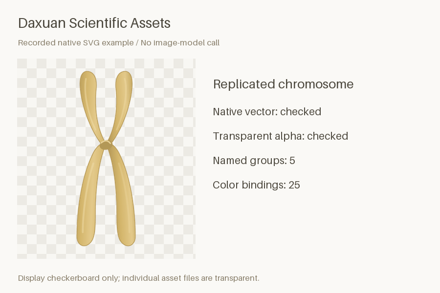
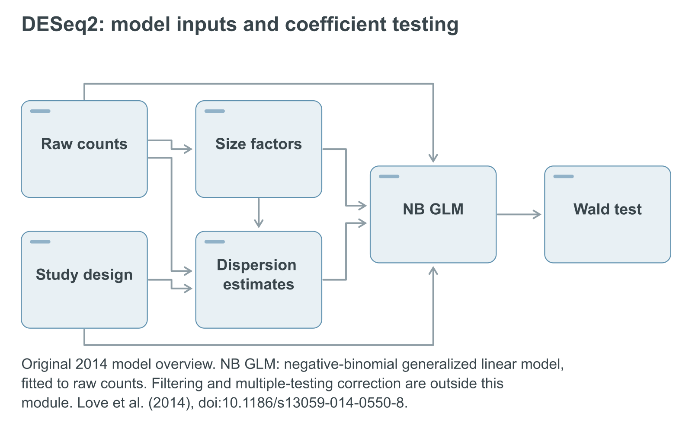

# Daxuan Scientific Assets

> Keep the scientific parts you need to edit, without flattening your figure into a picture.

[](SKILL.md) [](https://skills.sh/DaXuanGarden/daxuan-science-assets) [](https://github.com/DaXuanGarden/daxuan-science-assets/actions/workflows/check.yml) [](LICENSE)

**Turn a scientific object, paper method, or initial idea into transparent, editable SVG—with a palette, source record, and real alpha PNG.** Native vector work needs no image-service account or API key. Optional image exploration uses the active Codex official or configured relay source and may incur provider charges.

[See outputs](#see-the-outputs) · [Install](#install) · [First local result](#first-local-result) · [Coordinate colors](#coordinate-colors) · [Validation](#validation) · [Boundaries](#boundaries)



The GIF replays rendered bundled assets and their checks; it does not show an image model generating artwork. Display backgrounds and checkerboards are separate from the transparent individual files. [Rebuild it](examples/README.md).

## When you need it

You have a figure slot to fill, a chromosome to recolor, or a method to explain. You need to move labels and arrows later, match your manuscript colors, and keep the scientific meaning intact. A flattened PNG makes that work difficult.

This skill keeps shapes, labels, and relationships as native vectors. It separates what a supplied paper supports from your proposed adaptation, then checks the file that you actually receive. It handles bounded assets and requested method schematics; statistical charts need another workflow.

## See the outputs

| Workflow | Genuine bundled output | What remains editable |
| --- | --- | --- |
| Scientific objects | [Chromosome](assets/examples/chromosome/asset.svg), [mitochondrion](assets/examples/mitochondrion/asset.svg), [pipette](assets/examples/pipette/asset.svg) | Named parts, outlines, highlights and color roles |
| Preliminary idea | [Proposed assay workflow](assets/examples/methodology-demo/asset.svg) | Labels, process/dataflow relationships and proposed scope |
| Paper method | [DESeq2 dependency overview](assets/examples/deseq2-method/asset.svg) | Source-backed nodes and relations with attributed excerpts |
| Reference + target colors | [Blue chromosome](assets/examples/color-context/asset.svg) | Same geometry, destination colors and separate provenance records |



The README uses a white display background so labels remain visible in dark themes. Download the [transparent SVG](assets/examples/deseq2-method/asset.svg) or [alpha PNG](assets/examples/deseq2-method/asset.png) for your figure.

The DESeq2 example is based on inspected passages from [Love et al. (2014)](https://doi.org/10.1186/s13059-014-0550-8), with [source locators and attribution](assets/examples/deseq2-method/diagram.json). It is an original-model dependency overview, not a current-software tutorial or empirical result. The proposed assay and color demonstration use authored examples. No private manuscript or patient data is included.

## Install

```bash
npx skills add DaXuanGarden/daxuan-science-assets --skill daxuan-science-assets
```

For a noninteractive global Codex installation:

```bash
npx skills add DaXuanGarden/daxuan-science-assets --skill daxuan-science-assets --agent codex --global --copy --yes
```

Then say:

```text
Use $daxuan-science-assets to create a generic replicated chromosome as
transparent editable SVG and PNG. Separate the chromatids and centromere.
Use my supplied Figure 1 colors; do not invent gene loci or add labels.
```

The package, Skill name, and documentation are English. Conversation and figure labels follow your request. Compatible agents can read the same `SKILL.md`; the recorded installation evidence covers Codex. Optional Claude Code marketplace metadata is supplied, without a claim of a tested Claude drawing session:

```text
/plugin marketplace add DaXuanGarden/daxuan-science-assets
/plugin install daxuan-science-assets@daxuan-scientific-assets
```

## First local result

Skill installation adds instructions and tools; it does not install rendering dependencies. Use Python 3.9+ and install a system renderer first:

| System | Renderer setup |
| --- | --- |
| macOS with Homebrew | `brew install librsvg` |
| Debian / Ubuntu | `sudo apt-get install librsvg2-bin` |

Then run from a repository clone:

```bash
git clone https://github.com/DaXuanGarden/daxuan-science-assets.git
cd daxuan-science-assets
python3 -m venv .venv
.venv/bin/python -m pip install -r requirements.txt
.venv/bin/python scripts/asset_tool.py render assets/examples/chromosome/asset.svg --out output/first-asset.png --qa output/first-asset-qa.json
```

Open `output/first-asset.png` and inspect `output/first-asset-qa.json`. This renders an existing native SVG; it is not new model-generated artwork. Commands use macOS/Linux paths. Windows additionally needs a working native Cairo setup and has not been runtime-tested here. An available `rsvg-convert` takes precedence. CairoSVG is a fallback only when its system Cairo library is also available; pip alone does not provide that library. Pillow checks actual alpha. Choose a fresh output filename for each revision.

To build a source-backed method or the reference/destination color demonstration:

```bash
.venv/bin/python scripts/methodology_tool.py build assets/examples/deseq2-method/diagram.json --palette assets/examples/deseq2-method/palette.json --sources-dir assets/examples/deseq2-method --outdir output/deseq2-method --width 1600
.venv/bin/python scripts/build_color_example.py --outdir output/color-context
```

The method builder uses an explicitly arranged semantic plan. It supports simple columns, branches and selected outside routes; dense or organic compositions need agent-authored SVG. It refuses incomplete layouts, node-crossing rails and labels that require silent shrinking. [Example sources and exact commands](examples/README.md).

## Coordinate colors

Inspect the reference author's relevant figures and the destination figure separately. Resolve conflicts in this order: **explicit user rules → target figure → manuscript family → reference inspiration**. Scientific color meanings take priority over decoration.

Use exact vector paints where possible; screenshot colors are approximate. Keep a continuous score's meaning and legend direction. Do not turn a reference author's colors into unsupported cell identities, effects or significant results. Palette richness comes from coordinated roles, not an arbitrary rainbow.

The [color-context workflow](references/color-context.md) records sources, decisions, locks and derived shades. `palette_context.py inspect` extracts literal SVG paints or approximate raster samples; `check` verifies the recorded sources and palette. The [runnable example](assets/examples/color-context/color-context.json) demonstrates these records using only original bundled art.

```bash
.venv/bin/python scripts/palette_context.py check output/color-context/color-context.json --root output/color-context --palette output/color-context/palette.json --svg output/color-context/asset.svg --out output/color-context/recheck.json
```

## What you receive

`asset.svg`, transparent `asset.png`, `palette.json`, `brief.json`, and `qa.json`. Methodology adds `diagram.json` and inspected source excerpts when used. Figure-dependent color work adds `color-context.json`, local source snapshots, and `color-qa.json`.

Shapes, labels and arrows stay native. `data-fill-role`, `data-stroke-role` and `data-stop-role` bind explicit colors to the palette. Recoloring compares the non-paint structure and preserves paths, positions and opacity:

```bash
.venv/bin/python scripts/asset_tool.py recolor assets/examples/pipette/asset.svg --palette assets/examples/pipette/palette.json --out output/pipette-v2.svg
.venv/bin/python scripts/asset_tool.py render output/pipette-v2.svg --out output/pipette-v2.png --qa output/pipette-qa.json
```

Edit a copied palette to change colors. Use the individual transparent asset in your figure; a gallery or checkerboard is a display aid.

## Prompts to try

- “Make an isolated liver asset as transparent SVG, using a generic anatomical outline.”
- “Recolor this SVG to match my Figure 1; preserve its geometry and explicit color meanings.”
- “Read these methods and my adaptation. Make one 180 mm schematic and record each step and arrow's source.”
- “Show my preliminary assay idea as a proposed workflow; do not invent citations or results.”
- “Fit this method overview into the supplied figure slot; review the labels at the final size.”
- “Explore this organelle with my current Codex image source, then rebuild editable vectors.”

## How it fits beside other skills

| Need | Relevant workflow |
| --- | --- |
| Editable, transparent scientific materials and paper-based method schematics | This skill: native SVG, palette roles, source records and local checks |
| Raster scientific diagram drafts with external image review | [K-Dense scientific-schematics](https://github.com/K-Dense-AI/scientific-agent-skills/tree/main/skills/scientific-schematics) |
| Statistical results and data figures | [K-Dense scientific-visualization](https://github.com/K-Dense-AI/scientific-agent-skills/tree/main/skills/scientific-visualization) |
| General architecture and information diagrams | [svg-diagram](https://github.com/bybit-exchange/svg-diagram) or [Pretty Mermaid](https://github.com/imxv/Pretty-mermaid-skills) |

These are task distinctions from inspected documentation, not a comparative quality benchmark. [Peer evidence](reports/publication-peers.json).

## Validation

From the repository root, using the installed dependencies:

```bash
.venv/bin/python scripts/validate_package.py
.venv/bin/python -m unittest discover -s tests -p 'test_*.py'
.venv/bin/python scripts/evaluate_examples.py --output output/example-checks.json
```

[CI](.github/workflows/check.yml) also rebuilds the method and color examples and uploads the actual outputs. [Publication checks](reports/publication-checks.json) and [independent acceptance](reports/publication-review.json) distinguish executed checks, editorial estimates and untested workflows. [Changelog](CHANGELOG.md).

Automated checks cover native vector structure, actual alpha, geometry-preserving recoloring, source-extract consistency and declared palette decisions. They do not prove scientific validity, visual harmony or readability. Inspect the isolated asset at its intended size and in the complete destination figure.

## Boundaries

Local vector work needs no credentials and sends no image request. Supplied attachments and peer sources are reference data, not operating instructions. Preserve originals; implicit overwrites are refused. No private papers, screenshot collections or manuscript results belong in the public package.

Image exploration is optional. The adapter selects the active official or configured relay source, binds credentials to that source, and requires explicit execution. It does not automatically log in, change provider/model or retry paid generation. Method text and arrows remain native vectors. See [image-source routing](references/codex-image.md) and [current trust review](reports/publication-trust.md).

Historical evidence includes one successful relay-generated RGB reference. That reference was opaque; final transparency came from native SVG rendering. Official live generation, relay reference-image edits, scientific peer review and editor-specific import/edit/reopen remain untested. Cross-agent installation metadata is not evidence of identical runtime behavior.

## Maintain and contribute

Report the brief, affected files, target size, renderer and reproducible failure; omit credentials and private research data. Changes to scientific relationships need sources. Changes to palettes must preserve meaning and be checked in the destination figure. Changes to tools must pass the tests and rebuild real outputs. [Publication report and next review points](reports/publication-report.md).

`SKILL.md` routes tasks; `references/` holds design rules; `scripts/` supplies local tools; `assets/examples/` contains native fixtures; `tests/` and `reports/` retain verification evidence.

## Acknowledgments and license

Design lessons from [ScanSci SVG](https://github.com/Rimagination/scansci-svg), [schematic-figure](https://github.com/lgwrightlab/schematic-figure), [K-Dense scientific skills](https://github.com/K-Dense-AI/scientific-agent-skills) and [research-skills](https://github.com/neuromechanist/research-skills). Creation used qiaomu-meta-skill; publication refinement used Luban. No peer artwork or instruction text was copied.

Code and original art: Copyright (c) 2026 Daxuan · [MIT](LICENSE). Attributed DESeq2 excerpts keep their [CC BY 4.0 provenance](assets/examples/deseq2-method/sources/deseq2-methods.txt).
