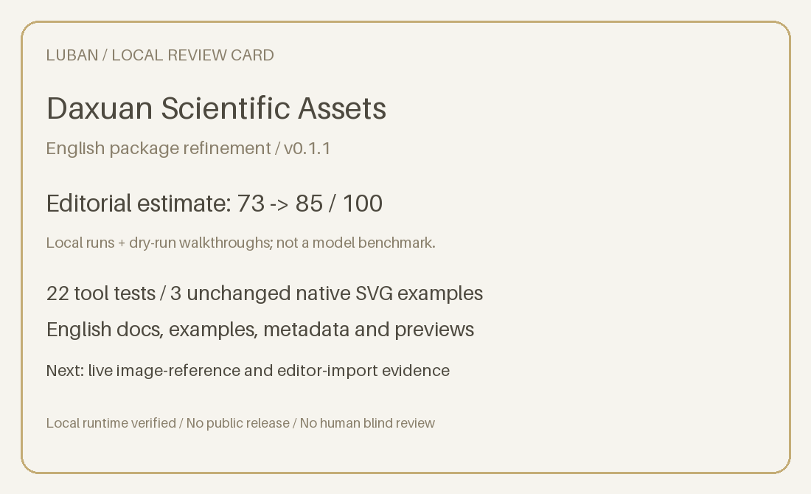

# Daxuan Scientific Assets: Luban polish report

Version 0.1.1, local preview. Date: 2026-10-19. This pass addresses the user's explicit request for an English skill and English name. It does not authorize public publication, new image providers, or a suite.

## 1. Premise challenge

- **Real problem: established.** Researchers need independent transparent illustrations that remain editable and recolorable in a workflow figure.
- **Distinct angle:** deterministic native-vector, alpha, and palette checks plus a bounded authoring contract. Generic drawing alone would be easy to duplicate; reusable tools and recorded examples are the installation reason.
- **Installation reason:** retain part groups and color roles, reject embedded-raster substitutes, and recheck actual transparency without rebuilding conventions in every conversation.
- **Shareable outcome:** a transparent SVG, actual preview, and reproducible gallery. Hook: scientific illustrations you can recolor without redrawing.

Conclusion: viable material; improve the English product surface while preserving the narrow scientific-asset scope.

## 2. Peer research

Live source/catalog inspection covered three peer categories. [Detailed evidence](peer-research.json) records URLs, dates, counters, failures and limitations.

| Peer | Category | Practical lesson | Not adopted |
| --- | --- | --- | --- |
| [ScanSci SVG](https://github.com/Rimagination/scansci-svg) | Direct | Existing vectors and semantic parts first | Broader scope; unlicensed assets/prose |
| [schematic-figure](https://github.com/lgwrightlab/schematic-figure) | Indirect | Editable-output promise and actual renders | Full-figure engine overhead |
| [scientific-schematics](https://github.com/K-Dense-AI/scientific-agent-skills) | Indirect | Bounded review, unavailable-evidence labels | PNG-only final output |
| [Transparent Icons](https://skills.sh/neuromechanist/research-skills/transparent-icons) | Direct task, different format | Literal name, palette and alpha checks | PNG as final editable SVG |
| [SVG Figure](https://skills.sh/neuromechanist/research-skills/svg-figure) | Indirect | Named groups and explicit handoff | Raster icon embedding |
| [Scientific Graphical Abstract Skill](https://clawhub.ai/jackkuo666/skills/scientific-graphical-abstract-skill) | Indirect, catalog only | Scenario-oriented English usage | Unverified broad quality claims |
| [Algorithmic Art](https://github.com/anthropics/skills/blob/main/skills/algorithmic-art/SKILL.md) | Craft | Concrete outputs and reproducible parameters | Unrelated art philosophy |
| [agent-browser](https://github.com/vercel-labs/agent-browser) | Craft | One purpose, one install, visible first result | Browser dependencies |

GitHub, skills.sh and ClawHub succeeded. Some raw GitHub fetches timed out and were replaced by API reads. Tessl was not searched. No peer code was run. Catalog counters and repository stars are separate adoption signals, not quality ratings.

## 3. Positioning

The skill started from a real gold scientific-asset request and remains an authoring workflow with small deterministic tools. A public-ready next stage needs live image and editor evidence, rather than a wider feature list.

Peers are easy to understand when their name states the artifact, the first prompt is usable, and an example can be inspected. This pass uses **Daxuan Scientific Assets**, keeps the English invocation `daxuan-science-assets`, and foregrounds transparent editable SVG. Conversation follows the user; distributed text and examples are English.

One-line positioning: **Transparent, editable SVG assets for scientific flowcharts.**

## 4. Live inspection and nine-dimension audit

The frozen baseline archive matches the original source files. Three existing native SVG/PNG pairs are replayed and compared byte for byte. The current 22 tool tests and 20 English lexical trigger cases pass; trigger configuration is not a measured model router.

There is no remote deployment, CI history, live data feed or public registry entry to inspect. These are inapplicable locally, not silently counted as passes. Real rendering, package commands, install behavior and assets are the relevant live artifacts. Full-figure anatomy and target editor behavior are not certified.

Text scanning changed from 25 files containing 9,635 CJK characters to zero such files/characters. The entrypoint shrank from 5,288 to 4,907 UTF-8 bytes (7.2%). All six original SVG/PNG files are byte-identical. The English gallery was inspected at 1200 px width and a separate stacked layout at 390 px width. Five documented commands passed after an isolated copy install, and three examples ran from an unrelated directory. These are package/fixture measurements, not generated-art quality gains.

The separate reviewer audit is recorded in polish-review.json. Scores are bounded editorial estimates using the nine Luban weights; they are not model quality measurements or human blind review. Final table and card are generated from that audit.

| Dimension | Weight | Baseline | Candidate | Evidence and main limit |
| --- | ---: | ---: | ---: | --- |
| Frontmatter and triggers | 7 | 5 | 6 | Matching English identity; lexical cases only. |
| Workflow clarity | 12 | 7 | 10 | English routes and explicit authoring step; dry-run walkthroughs. |
| Failure encoding | 12 | 8 | 10 | Readable fallback/failure actions; deterministic probes only. |
| Checkpoints | 6 | 5 | 5 | Actual renders and 200px review; same substantive gates. |
| Executable specificity | 17 | 12 | 15 | Real fixture paths and copyable English commands; not one-command drawing. |
| Resource integration | 4 | 3 | 3 | Relative resources and valid local links; architecture already existed. |
| Architecture | 12 | 9 | 11 | One entrypoint, English identity, shorter core; not a full language classifier. |
| Runtime behavior | 23 | 18 | 18 | 22 tests and 3 fixtures each; no provider/editor evidence. |
| Negatives and boundaries | 7 | 6 | 7 | English exclusions and prompt-only adapter limitation; not a security audit. |
| **Total** | **100** | **73** | **85** | **Independent agent editorial estimates** |

The runtime score deliberately stays equal. Gains are attributed to English comprehension and packaging. Both representative walkthroughs were assessed as clearer; no timed human study or model-art comparison was conducted. Full evidence and limits for every dimension are preserved in [polish-review.json](polish-review.json).

## 5. Gaps

- **P0 for the requested English handoff:** all entrypoint, metadata, references, example briefs/prompts, reports and preview labels must be English; native assets and installation must remain usable. Checked before final handoff.
- **P1 before claiming broader quality:** perform a real image-reference request and an editor import/edit/save/reopen trial. Keep both missing evidence until actually done.
- **P2 for public distribution:** choose a remote repository, registry and optional marketplace packaging, then verify public-source installs and rendered README. No fake badge or repository is added locally.

Three gaps relative to wider peers: provider evidence, editor evidence, and public discovery. Three opportunities: a narrow native-asset promise, geometry-preserving palette edits, and reproducible small examples.

## 6. Three refinement directions

| Direction | Scope | Benefit | Cost or risk |
| --- | --- | --- | --- |
| A: English clarity | Name, instructions, examples, metadata, first-run wording | Directly resolves this request without migrating the slug | Requires a complete language and reference check |
| B: Image-to-vector evidence | Real model references and independent editing trials | Tests the plausible complex-object benefit | Requires a working backend and new evaluation scope |
| C: Small suite | Split authoring, recoloring and composition | Could serve broader workflows | More installation/routing complexity; explicit scope decision needed |

Recommendation: A now. The user already specified this direction, so the authorized English work is executed without another selection question. B and C remain future options, not implied authorization. No suite or new provider is introduced.

## 7. Candidate rewrite and preservation gate

This round changes one facet: English product identity and comprehension. The baseline is preserved outside the package. Core SVG/adapter interfaces, asset IDs, geometry, and palette values are preserved.

| Files | Change | Reason |
| --- | --- | --- |
| SKILL.md, README.md, agents/ | English name, routes, first prompt, language rule | Understand the job and invoke it without translation |
| references/, briefs, prompts, evals, reports | English content with consistent evidence labels | Prevent a partly translated package |
| build_showcase.py and generated images | Reproducible English presentation of real vectors | Inspect the actual deliverables |
| validate_package.py | Identity, language, links, trigger smoke and optional baseline checks | Keep the verification method for the next maintainer |

Direct replacement excerpt, already applied:

```text
# Daxuan Scientific Assets
Create transparent SVG assets that researchers can combine, edit, and recolor.
Match the user's conversation language; keep package documentation and bundled examples in English.
```

Two representative English instruction walkthroughs are reviewed independently: create a chromosome and recolor an existing pipette. These are explicitly dry-run document-comprehension comparisons. Actual deterministic operations also run on the unchanged fixtures. No matched model-output preference experiment exists, so a claim that generated art improved is unsupported.

## 8. README and showcase

The first screen names the artifact and shows real examples. Quick start uses a local install command and a copyable invocation. A runnable preview command produces a real PNG and QA report. Initialization is clearly distinguished from artwork generation.

The gallery and sample animation are rebuilt by scripts/build_showcase.py from actual rendered SVGs. The animation is labeled a fixture preview, not a recording of model generation. Dependencies are split between native tools, rendering, and optional image references. No public install badge is invented. Luban structural audit changed from 8 pass / 5 warn / 0 fail to 10 pass / 4 warn / 0 fail. Remaining warnings concern the assets/examples directory location, a Python rather than VHS recorder, and unrequested marketplace/public-badge metadata; see release-check.json for their individual interpretation.

## 9. Execution plan

- **This pass:** English identity and package text, frozen baseline, peer research, actual command replay, independent editorial review, local install refresh, report and card.
- **Next evaluation pass:** when a backend is ready, generate one reference, reconstruct one vector, and record the real files and failures; independently test an editor workflow.
- **Before public release:** user selects a repository/channel, reviews claims and then explicitly authorizes that publication action.

Time windows are planning groups, not promises or scheduled work. No automation was created.

## 10. Review card



Independent agent editorial estimate: **73 to 85 / 100**. Two dry-run instruction walkthroughs improved in English comprehension; runtime behavior remained equal. The card states that scores are editorial judgments, runtime results cover deterministic tools, and provider/editor evidence remains missing. It is not scientific certification.

## 11. Follow-up discipline

Watch ScanSci's part-editing examples, schematic-figure's reproducibility workflow, and research-skills' theme/editor conventions during the next requested review. No background monitor was created.

Keep release notes explaining why a change exists. Run language/link/identity checks and fixture preservation for text-only revisions. Keep provider and editor evidence separate. This round does not widen scope, add providers, infer mechanisms, or publish. Next entrypoint: the first real complex asset that needs image exploration.

## 12. User decisions

None required for the already authorized English refinement. Public publishing, a new image provider, and suite expansion require a later explicit request.

## 13. Sources

All peer URLs and observed limits are in [peer-research.json](peer-research.json) and [prior-art-research.md](prior-art-research.md). Frozen baseline metrics are in baseline-evidence.json; current executable evidence is in package-validation.json, output-evidence.json, unit-tests.json and install-evidence.json. Creation used qiaomu-meta-skill; this refinement used the user-invoked Luban method.
