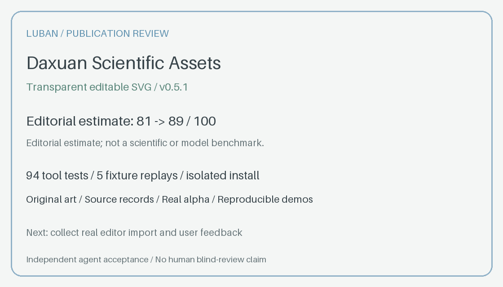

# Daxuan Scientific Assets — Luban publication report

Version 0.5.1 · 2026-10-19 · [Independent acceptance](publication-review.json) · [Executed checks](publication-checks.json)

## 1. Premise challenge

- Real problem: established. Researchers need editable, transparent components and source-backed method overviews that fit a larger figure.
- Distinctive angle: local SVG/alpha/recolor tools, explicit method/source records, and separate reference/destination color context. No claim that general image-generation capability is unique.
- Installation reason: reusable checked tooling and output contracts, rather than repeating format, transparency and evidence requirements in every prompt.
- Shareable result: genuine SVG/PNG examples, a replayable fixture GIF and a source-derived method example.

Verdict: suitable for public distribution. Keep the bounded scientific-material scope.

## 2. Peer research

Current GitHub and catalog inspections cover direct, adjacent and craft peers. Full URLs, observed commits, caveats and search failures are in [peer evidence](publication-peers.json). No peer was installed or paid generation invoked.

| Peer | Type | Learn | Do not transfer |
| --- | --- | --- | --- |
| [K-Dense scientific-schematics](https://github.com/K-Dense-AI/scientific-agent-skills/tree/main/skills/scientific-schematics) | Direct | Explicit formats, versioned review records, input/output guide | Raster output does not establish editable SVG |
| [SciDraw](https://clawhub.ai/toplocalai/skills/scidraw-ai-scientific-illustration) | Direct | Backend, costs and acceptance criteria visible | Service credits and raster delivery are different requirements |
| [K-Dense scientific-visualization](https://github.com/K-Dense-AI/scientific-agent-skills/tree/main/skills/scientific-visualization) | Adjacent | Destination size and color semantics before styling | Statistical plots are outside this skill's scope |
| [SciPilot](https://github.com/Haojae/scipilot-figure-skill) | Adjacent | Distinct code and rendered-output audits | Its inspected instructions exclude method diagrams |
| [svg-diagram](https://github.com/bybit-exchange/svg-diagram) | Craft | Native output gallery and actionable lint | Its white-canvas rule conflicts with transparent materials |
| [Pretty Mermaid](https://github.com/imxv/Pretty-mermaid-skills) | Craft | Retained source and precise reproduction commands | A renderer does not verify scientific meaning |
| [canvas-design](https://skills.sh/anthropics/skills/canvas-design) | Craft | Clear final formats and visual hierarchy | Creative philosophy does not establish scientific support |
| [charmed-vhs](https://tessl.io/registry/tpscloud/charmedimsure) | Craft | Demo source shipped with generated output | Terminal stack and registry scores do not validate this skill |

Tessl's legacy scientific search URL redirected to unfiltered discovery; no directly matching scientific SVG Skill was established there. An actual linked craft listing was inspected instead.

## 3. Position

The initial need was a reusable scientific asset for an existing flowchart. The package now combines native illustration with bounded, source-backed method diagrams. Its next public step is a reliable installation-to-visible-output path.

Position: **Transparent, editable scientific materials with source and palette records you can check and revise.**

## 4. Three measures and nine dimensions

Live local artifacts were rendered and checked, not inferred from status labels. A fresh dependency environment ran the existing suite; the independent reviewer installed a project copy and executed its tools. No hosted CI or remote-install success was assumed before push; those records are attached to the GitHub release after execution.

Scores below are independent agent editorial estimates, supported by deterministic probes and two dry-run onboarding comparisons. They are not measured human comprehension, model quality or scientific accuracy.

| Dimension | Weight | Baseline | Candidate | Evidence and remaining limit |
| --- | ---: | ---: | ---: | --- |
| Frontmatter and triggers | 7 | 6 | 6 | Stable name/scope; lexical routing is not model accuracy |
| Workflow clarity | 12 | 10 | 11 | Remote install and explicit first-result path; art remains an agent task |
| Failure modes | 12 | 10 | 10 | Existing failure tests retained; native Cairo setup is now explicit |
| Checkpoints | 6 | 5 | 5 | Source/alpha/palette checks and visual review; science remains reviewed separately |
| Executable specificity | 17 | 13 | 16 | Pinned direct dependencies, six actual CLI walkthroughs and new color reproduction |
| Resource integration | 4 | 3 | 4 | Examples index and current trust/evidence links |
| Architecture | 12 | 10 | 11 | One root Skill, optional plugin manifests and CI with artifact output |
| Executed performance | 23 | 18 | 20 | 94 tests, five fixture replays and installed-copy use; no new-art comparison |
| Exclusions | 7 | 6 | 6 | No statistical-plot, invented-source or editor-import claims added |
| **Editorial estimate** | **100** | **81** | **89** | [Evidence and scoring rationale](publication-review.json) |

A forced CairoSVG fallback on macOS failed without native Cairo. This exposed a setup gap; README now requires system librsvg/Cairo, and CI explicitly installs librsvg. The supported local librsvg route rendered actual transparent outputs. Pip-only rendering is not promised.

## 5. Gaps

Closed publication gaps: local-only installation text; missing direct dependency manifest; missing complete system-renderer setup; no runnable color-context example; absent marketplace metadata; absent hosted native-output workflow; current public trust navigation.

Remaining evidence limits: remote installation and CI must be checked against the published commit; no editor import/edit/reopen, independent scientific review, new official generation, or relay image-edit result. The public record keeps these distinct from local test passes.

Compared with peers, the main opportunities are repeatable vector edits, color decisions traced to reference and target sources, and a compact method/source record. More features are not required for this release.

## 6. Three directions

- A — Public distribution refinement: clarify installation, real outputs and verification. Chosen within the user's explicit publish-and-polish scope.
- B — Broader visual demonstrations: add more supported methods and controlled image-reference-to-vector case studies after real demand and source review.
- C — Multi-skill suite: separate asset generation, statistical figure work and manuscript planning. Outside this request; would need a new scope decision.

## 7. Accepted candidate changes

This round changes the public distribution surface. Existing vector, source-routing, methodology and palette-check tools remain unchanged. The original runtime, tests and individual examples were compared with the frozen 0.5.0 archive; [preservation record](publication-checks.json).

Accepted files: README, pinned direct dependencies, examples index, an original color-context replay script/fixture, optional plugin manifests, native-output CI, version/changelog and public evidence. Three historical reports replace the locally used relay hostname with a reserved example domain and state the redaction. No scientific relationship or accepted private material was republished.

Copyable installed prompt:

```text
Use $daxuan-science-assets to create a transparent editable SVG and PNG.
Use the supplied Figure 1 palette and record its relation to the reference.
Preserve explicit color meanings; do not invent gene loci or results.
```

## 8. README and showcase

README leads with formats, no-key native work, actual outputs and the source install command. Dependencies and system setup precede the first render. Acknowledgments, current trust boundaries and comparison links remain visible. The GIF is an honest replay of rendered fixtures, not an image-generation recording.

`build_showcase.py` reproduces desktop/mobile galleries and GIF. `build_color_example.py` reproduces the new native SVG/PNG with source/context/QA files. `build_publication_card.py` renders the result card from the recorded review. Existing individual asset PNGs and SVGs are preserved.

## 9. Execution plan

- Completed locally: freeze baseline, peer research, candidate edits, original example replay, isolated installation, privacy scan, independent acceptance and metadata checks.
- Publication gate: push the reviewed commit; inspect the exact hosted checks and download their real SVG/PNG/QA artifacts; run remote source installation and installed commands; attach the resulting record and archive to the GitHub version.
- Next user-feedback entry: collect an editor import/edit/reopen example and final-size layout feedback. No unattended follow-up is scheduled.
- Outside this round: extra registries, paid image calls, private manuscript publication and a skill suite.

## 10. Publication review card



Reproduce with `python3 scripts/build_publication_card.py --review reports/publication-review.json --out output/publication-card.png`. The 81→89 scores are explicitly editorial estimates, not a scientific/model benchmark.

## 11. Next review points

Watch the format/source/review contracts of scientific-schematics, native lint examples of svg-diagram, and reproducible-source practices of Pretty Mermaid. Revisit after concrete user feedback or backend changes; do not expand scope merely because a peer adds features.

Iteration rule: preserve old versions, state why a change is needed, rerun matching checks, and inspect actual new outputs. Scientific topology changes require evidence; palette changes require semantic and placement review. Keep test outcomes separate from visual and scientific acceptance.

## 12. User decisions

No unresolved local decision blocks this publication. The user explicitly requested improvement and GitHub publication under DaXuanGarden. The canonical repository name follows the Skill identifier. No other repository, registry, profile page or private research output is modified.

## 13. Sources

All peer URLs and inspected source/commit details: [publication-peers.json](publication-peers.json). Authoring and methodological references: [README acknowledgments](../README.md#acknowledgments-and-license), [source-backed example](../assets/examples/deseq2-method/diagram.json), and [color-context rules](../references/color-context.md).
